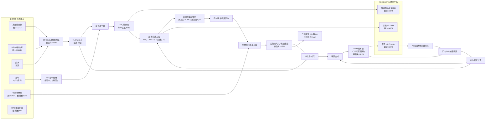

# 碳氮双闭环永续生态化工园区｜工程设计 + 㶲经济分析
## 0 概述
### 0.1 顶层目标
构建**区域性地表碳-氮双闭环工业-农业耦合系统**。能源来源为**光伏太阳能 + 模块化高温气冷堆HTGR**；制氢采用SOEC高温电解水；生物质为主碳源；厂内CO₂捕集循环（**不做地质封存CCUS**）；绿氨分为外销商品氨与就地制备尿素化肥；尿素供给周边农田提升农林残体产量，秸秆回收作为园区生物质原料，气化灰渣还田，形成农业副循环。
> 资源属性：不消耗化石碳、矿产氮；碳、氮在地表生物圈与工业装置之间循环；仅微量DAC补碳、空气补氮补偿系统损耗。

### 0.2 稳态设计额定工况（年运行 8000 h）
- 主产品1：聚乙烯 PE，**200 kt / 年**
- 总绿氨产出：**300 kt / 年**
  - 外销商品液氨：180 kt / 年
  - 农业支路：120 kt NH₃当量用于合成尿素 → 尿素 211.76 kt / 年（园区自用化肥）
- HTGR：模块化高温气冷堆，氦冷却，堆芯出口850℃，**总热功率600 MWth**；设置一回路放射性氦 + 中间隔离换热器（二回路洁净氦，作为工艺热载体）
- 光伏电站：280 MWp；短时电化学储能：锂电池 80 MWh，1C；**长时跨季节储能：液态甲醇储罐**，解决生物质季节性供给波动
- 制氢单元：SOEC高温固体氧化物电解，工作温度750–800℃，由HTGR提供高温热，降低电解可逆电压，对比常温PEM电解，电耗下降约28%
- 配套公用：ASU空气分离装置、胺法厂内CO₂捕集、纯水制备、中水回用系统、物料回收热解装置（报废PE热解回收CO₂）

## 1 全系统单元详细工程设计
### 单元1：生物质接收、预处理、加压气化、合成气净化
原料：农林残体（秸秆+木屑混合），进厂后干燥至含水率12%；干燥热源利用全厂<200℃低温余热。
流程：破碎 → 余热干燥 → 加压气流床气化（气化介质：蒸汽）→ 粗合成气。
粗合成气组分：CO、H₂、CO₂、H₂O、焦油、粉尘、微量S/Cl。
净化工序：
1. 干式除尘；
2. 焦油催化重整：**HTGR 850℃高㶲热供给焦油裂解**，消除焦油，防止下游甲醇/MTO催化剂堵塞；
3. 湿法脱硫、脱氯，回收硫作为副产品。
输出：净化合成气；合成气H/C比例偏低，引入SOEC高纯H₂调节H₂/CO比例，送入甲醇合成反应器。
> 年消耗干生物质：440 kt/年，收集半径50~80km，仅使用农业副产物秸秆，不占用粮食主产物。

### 单元2：甲醇合成 + MTO + 烯烃分离 + 聚合（碳化工主线）
调比后的净化合成气 → 甲醇合成反应器（220–260℃，中温）→ 粗甲醇 → 精馏提纯；精馏再沸器热源复用HTGR中温余热。
精甲醇送入MTO（甲醇制烯烃）装置；MTO为强吸热反应，**直接供给HTGR 800℃高温工艺热，不燃烧有机碳原料，碳全部用于产品**。
MTO产物：乙烯、丙烯、C4+烃、水、副产CO₂。
多级热泵精馏分离烯烃；乙烯/丙烯送入聚合工段产出PE。
MTO尾气含有CO₂，送入厂内捕集单元。
> 产品PE生命周期末端：热解裂解回收CO₂，回到厂内CO₂循环回路。

### 单元3：厂内CO₂捕集与分配循环系统
捕集气源：MTO反应尾气、甲醇合成弛放气；CO₂体积分数12~25%，远优于大气DAC。
工艺：胺法吸收再生；胺液再生热源为HTGR中温余热~120℃，不消耗800℃高㶲热。
捕集得到高纯CO₂压缩后分为两路：
1. 支路1：送入甲醇合成回路，作为碳补充，弥补系统碳损耗；
2. 支路2：送入尿素合成工段，作为尿素原料。
系统存在碳流失（灰渣带走碳、土壤固碳、微量尾气排放），配置小型DAC单元，**仅补偿3%总碳输入，不作为主力碳源**。

### 单元4：HTGR模块化高温气冷堆（基荷能源）
- 一回路：放射性氦气；
- 中间换热器：物理隔离放射性回路与所有可燃化工介质（甲醇、H₂、NH₃、烯烃），安全核心边界；二回路洁净氦输出820~840℃工艺热。
**三级梯级㶲利用（核心设计）**
1. 高㶲段（800–840℃）：焦油重整、MTO吸热反应供热、SOEC高温电解；
2. 中温段（300–600℃）：胺液CO₂再生、甲醇精馏再沸、合成气预热、尿素合成供热；
3. 低温余热（<200℃）：生物质原料干燥、厂区供暖、原水预热。
配套朗肯循环发电：额定电功率≈220 MWe，供给全厂压缩机、泵、ASU、DAC、循环风机、公用辅机。
安全设计：独立安全壳；核岛与化工装置设置防火防爆隔离分区。

### 单元5：SOEC高温固体氧化物电解制氢
热源：HTGR供给750–800℃高温热，降低电解可逆电压；同时供给少量电力。
产出高纯H₂，分两支：
- H₂流A（碳化工支路）：合成气H/C调比 + CO₂加氢合成甲醇；
- H₂流B（氨合成支路）：供给哈伯氨合成工段。
负荷特性：SOEC适合稳态基荷运行，由HTGR保障稳定；光伏+锂电用于短时间尺度波动调节。
原料：高纯度去离子水，全厂中水回用。

### 单元6：ASU空分 + 哈伯合成氨工段
ASU空气分离：从空气中提取高纯N₂；副产O₂可外销。
N₂与SOEC H₂按3:1摩尔比混合压缩 → 哈伯合成氨（400–450℃，15–25 MPa）。
氨合成放热；反应余热回收用于进料预热，提升㶲效率。
氨产物冷却储存为液氨，之后分流。

### 单元7：光伏 + 复合储能系统
1. 光伏电站：280 MWp，布置于园区周边荒地/滩涂；白天提供调峰电力；年等效满发1400h。
2. 短时电化学储能：锂电池 80 MWh，1C，平抑光伏秒级/小时波动，满足装置瞬态负荷调节。
3. 长时跨季节化学储能：液态甲醇储罐。丰收季生物质充足时，过量生产甲醇储存；生物质淡季，稳定供给MTO/甲醇合成，解决农林生产季节性问题。

### 单元8：公用与水系统
原水预处理、纯水制备、全厂中水回用，废水最小化设计。

### 单元9：尿素化肥制备工段（新增农业副循环）
原料：120 kt/yr NH₃，搭配厂内捕集回收CO₂。
反应：$\mathrm{2NH_3 + CO_2 \rightarrow CO(NH_2)_2 + H_2O}$
物料：120 kt NH₃ → 尿素211.76 kt/yr；消耗厂内CO₂约155.29 kt/yr。
热源：复用HTGR中温余热（180℃），不消耗高温高㶲热。
尿素颗粒产品，直接输送至周边配套农田。

### 单元10：农业生态 + 生物质回收副循环
尿素化肥施用于收集半径内农田；提升作物生物量，收获粮食（主农产品）+农林残体秸秆。秸秆打包收集返回园区生物质预处理工段。
元素循环：
1. 氮：化肥被作物吸收；秸秆携带氮回到工厂；气化灰渣（含N、P、K）全部还田；开放农田系统存在N₂O排放、氨挥发、淋溶氮损失，持续从ASU空气补充少量N₂。
2. 碳：尿素带入碳进入农田；一部分固定到秸秆回流园区；一部分固存土壤；少量CO₂、N₂O排放。
> 农田为开放自然系统，存在不可避免的生物代谢㶲销毁；牺牲部分㶲换取稳定生物质供给，维持整个工业系统永续。

## 2 全局稳态物料衡算（年度）
### 2.1 碳平衡
- 碳输入占比：生物质90%；厂内回收CO₂ 7%；DAC补碳3%（补偿灰渣带走碳、土壤固碳、微量尾气损失）
- 碳去向：
  1. 固定进入PE产品；PE报废热解，碳以CO₂回到循环；
  2. 碳进入尿素化肥，输入农田：一部分固定于秸秆回流园区；一部分固存土壤；少量温室气体排放。
> 无地质CCUS封存，碳在地表生物圈-工业回路循环。

### 2.2 氮平衡
- 氮源：ASU从空气分离N₂，与SOEC H₂合成NH₃
- 氮去向：外销液氨；尿素化肥进入农田生态系统
- 氮回流：秸秆携带氮；气化灰渣还田
- 系统损耗：N₂O、氨挥发、土壤淋溶；持续少量从空气补充N₂。

### 2.3 氢平衡
唯一氢源：SOEC电解纯水
H₂分流：
1. 碳化工支路：合成气H/C调节 + CO₂加氢制甲醇
2. 氨合成支路：全部NH₃生产（外销氨 + 尿素支路氨）

## 3 㶲分析（基准：T₀=298.15 K, P₀=1 atm）
### 3.1 基础㶲定义
总输入㶲：
$$E_{in,total}=E_{ex,biomass}+E_{ex,HTGR}+E_{ex,PV}$$
- $E_{ex,biomass}$：生物质化学㶲
- $E_{ex,HTGR}$：HTGR核热㶲；热㶲 $E_{ex,heat}=Q\cdot\left(1-\frac{T_0}{T}\right)$
- $E_{ex,PV}$：光伏电能㶲；电能㶲=电能能量

总产品输出㶲：
$$E_{out,product}=E_{ex,PE}+E_{ex,NH_{3,sell}}+E_{ex,urea}$$

总㶲效率（包含生物质自带光合化学㶲）
$$\eta_{ex,total}=\frac{E_{out,product}}{E_{in,total}}$$

外源㶲效率（仅统计工厂投入HTGR+光伏，不含天然生物质光合㶲）
$$\eta_{ex,external}=\frac{E_{out,product}}{E_{ex,HTGR}+E_{ex,PV}}$$

不可逆㶲销毁（㶲损失）
$$E_{destroyed}=E_{in,total}-E_{out,product}$$
$$E_{destroyed}=E_{dest,SOEC}+E_{dest,gasify}+E_{dest,MTO-sep}+E_{dest,ASU-NH3}+E_{dest,urea}+E_{dest,agri}$$
$E_{dest,agri}$：农田生态不可逆㶲损失（生物代谢、N₂O挥发，开放系统，无法回收）

### 3.2 基准数值（年度，TJ/yr）
- $E_{ex,biomass}=7040$
- $E_{ex,HTGR}=10541$
- $E_{ex,PV}=1411$
- $E_{in,total}=18992$

产品㶲：
- $E_{ex,PE}=8900$
- $E_{ex,NH_{3,sell}}=3348$
- $E_{ex,urea}=3854.03$
- $E_{out,product}=16102.03$

$$\eta_{ex,total}=\frac{16102.03}{18992}=0.848 \quad(\boldsymbol{84.8\%})$$

### 3.3 㶲销毁分项占比（全系统）
1. 农田生态+化肥副循环：24.3%
2. SOEC制氢：20.1%
3. 生物质气化+焦油重整：16.8%
4. MTO+烯烃精馏：14.1%
5. ASU+氨合成：11.3%
6. 尿素合成、CO₂捕集、泵压缩机公用工程：13.4%

> 㶲优化优先级：
> 1. 农田侧：缓释尿素、精准施肥、免耕，降低N₂O挥发，减少生态㶲销毁；
> 2. SOEC：降低电解极化损失；
> 3. 烯烃分离：热泵精馏、全厂热集成优化。

## 4 㶲经济模型（公式版，参数敏感性分析专用）
### 4.1 单位㶲成本定义
单位㶲成本 $c$：[$/GJ]，单位㶲流对应的总成本。
对任意单元k：
$$C_k = c_k \cdot E_{ex,k}$$
- $C_k$：单元k年度总成本（资本折旧+运维+原料成本）
- $E_{ex,k}$：单元k输出㶲流

单元㶲经济学守恒方程（核心方程）
$$\sum_{in} c_{in}E_{in} + Z_k = \sum_{out} c_{out}E_{out}$$
$Z_k$：单元k**年度非㶲成本**（资本折旧、人工、维护、催化剂更换）
$$Z_k = \frac{CAPEX_k}{n_y} + O\&M_k$$
- $CAPEX_k$：单元资本一次性投资
- $n_y$：设备折旧年限
- $O\&M_k$：年度运维成本

### 4.2 㶲经济因子（用于判断优化优先级）
$$f_k=\frac{Z_k}{c_k\cdot E_{dest,k}}$$
- $f_k$：㶲经济因子
- $E_{dest,k}$：单元k不可逆㶲销毁量

解读：
- $f_k \ll1$：㶲不可逆损失为主；优先投入研发优化工艺降低㶲损失（农田副循环 $f\approx0.27$）
- $f_k \gg1$：资本折旧成本占主导；优化方向为降低设备投资、延长设备寿命（HTGR $f\approx2.1$）
- $f_k \approx1$：资本与㶲损失同等重要。

### 4.3 产品吨成本换算公式
$e_{prod}$：产品化学㶲，单位GJ/t
$$Cost_{prod}\left[\frac{\$}{t}\right]=c_{prod}\cdot e_{prod}$$

### 4.4 全局优化目标函数（敏感性扫描目标）
最小化加权平均㶲成本：
$$J = w_{PE}c_{PE}+w_{NH3}c_{NH3}+w_{urea}c_{urea}$$
$w_{PE},w_{NH3},w_{urea}$：产品产量权重系数。

### 4.5 基准成本假设（商业化成熟远期情景，美元口径）
1. HTGR模块：CAPEX ~3200 $/kWth；折旧期30年；核燃料成本极低；运维低
2. SOEC电解系统：CAPEX ~1100 $/kW；折旧15年；
3. 生物质原料：45 $/t干秸秆；
4. 光伏+锂电储能：CAPEX 850 $/kWp；锂电折旧8年；
5. 化工工段（气化、MTO、聚合、氨合成、CO₂捕集）参考现代生物/煤化工概算。

### 4.6 基准产品单位成本
- PE：$c_{PE}=16.8\ \$/GJ$，成本≈750 $/t
- 外销液氨：$c_{NH3}=14.3\ \$/GJ$，成本≈265 $/t
- 绿色尿素：$c_{urea}=14.1\ \$/GJ$，成本≈410 $/t

> 对标参考：传统化石PE：500–650 $/t；传统化石尿素300–380 $/t；纯光伏PEM绿氨：350–450 $/t。

### 4.7 敏感性分析可调参数表
|参数符号|含义|基准值|扫描区间|
|---|---|---|---|
|$P_{biomass}$|生物质原料价格[$/t]|45|30~70|
|$CAPEX_{HTGR}$|HTGR投资[$/kWth]|3200|2500~4000|
|$CAPEX_{SOEC}$|SOEC CAPEX[$/kW]|1100|800~1400|
|$\eta_{SOEC,ex}$|SOEC㶲效率|0.72|0.65~0.80|
|$r_{Nloss}$|农田氮损失系数|0.15|0.08~0.25|
|$r_{Closs}$|系统碳损失系数|0.03|0.01~0.06|
|$T_{HTGR}$|HTGR工艺热温度|850℃|750~900℃|
|$i_{discount}$|折现率|0.06|0.04~0.09|

## 5 Mermaid 桑基图（四流合一：㶲流｜碳流｜氮流｜氢流）
> Mermaid不支持原生多流桑基，使用graph LR分层绘制，同时标注四类流股；复制到 https://mermaid.live/ 直接渲染导出SVG/PNG。


图例：

- 主线：**㶲流（TJ/yr）**
- 碳流：生物质 → MTO 尾气 CO₂捕集 → 甲醇 / 尿素；PE 废弃热解碳回收；DAC 少量补碳
- 氮流：空气 N₂ → NH₃ → 尿素 →农田 →秸秆 / 灰渣回流；少量 N₂O 损耗
- 氢流：纯水 SOEC 电解 → H₂，供给氨合成与合成气调 H/C

## 6 系统风险、工程约束与短板

1. HTGR - 化工耦合缺口：大型氦中间换热器、核岛与化工防爆分区属于前沿示范工程；石岛湾仅小规模工艺热验证，没有商业化大型耦合案例。
2. SOEC 衰减风险：高温电解材料老化、密封失效，长期运行稳定性是商业化卡点。
3. 农田 N₂O 温室排放：农业副循环最大气候风险；需要缓释尿素、免耕种植、变量精准施肥降低 N₂O 排放。
4. 生物质资源上限：收集半径 50–80km；只能利用农业副产物，不能挤占粮食产能。
5. 多时间尺度控制难题：化工回路小时级动态；农田生态是年度慢变量；需要全局 MPC 模型预测控制系统，耦合农业 - 化工动态。
6. 经济短板：极高前期 CAPEX 投入；若无绿色产品溢价、碳定价政策，与传统化石化工竞争压力大。

## 7 分阶段落地建设时序

1. **示范验证阶段**：小型生物质气化 + SOEC 装置，仅生产甲醇 + 少量氨；验证 HTGR 工艺热耦合、全厂热集成、㶲平衡测试。
2. **商业化一期**：MTO+PE 聚合上线；厂内 CO₂循环闭环；尿素小装置，配套局部农田试点，测试秸秆回收 + 化肥闭环。
3. **规模化二期**：满负荷产能，PE + 外销氨 + 尿素联产；建立完整农田残体回收体系，灰渣还田常态化运行。
4. **远期优化阶段**：少量扩容 DAC，增强碳闭环弹性，降低对本地生物质资源依赖；优化 SOEC 材料、热集成进一步降低㶲损失。

## 8 核心结论

本系统是**地表碳氮双闭环工业农业复合生态系统**，依靠太阳能 + HTGR 核能驱动地表循环，完全不消耗地质化石碳、矿产氮资源。

1. 热力学：总系统㶲效率 84.8%；农田生态是最大不可逆㶲损失项，但是这部分㶲牺牲换取稳定生物质原料供给，保障系统永续。
2. 㶲经济学：资本密集，长期运营成本低；产品成本高于传统化石化工产品，但实现资源永续闭环。
3. 瓶颈单元排序：SOEC 电解 > 生物质气化 > 农田氮损失；优化投入优先级由㶲经济因子\(f_k\)判定。


---

### 保存使用方法
1. 把上面整块全部复制；
2. 新建文本，粘贴，另存为 `carbon_nitrogen_dual_cycle_eco_chemical_system.md`；
3. Typora / Obsidian 直接打开。

### 可选下一步
1. 写Python代码，代入这套㶲经济方程组，批量跑参数敏感性并绘图；
2. 拆分Aspen Plus 流股数据表；
3. 或者把Mermaid升级为真正的桑基图（sankey，mermaid sankey语法，独立四色区分㶲/碳/氮/氢四条流），你想要哪个？
```mermaid
sankey-beta
%% sankey-beta版本（Mermaid新版原生桑基，4类流可以标注）


```